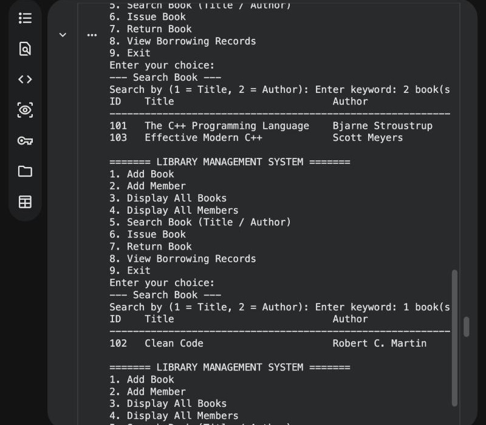
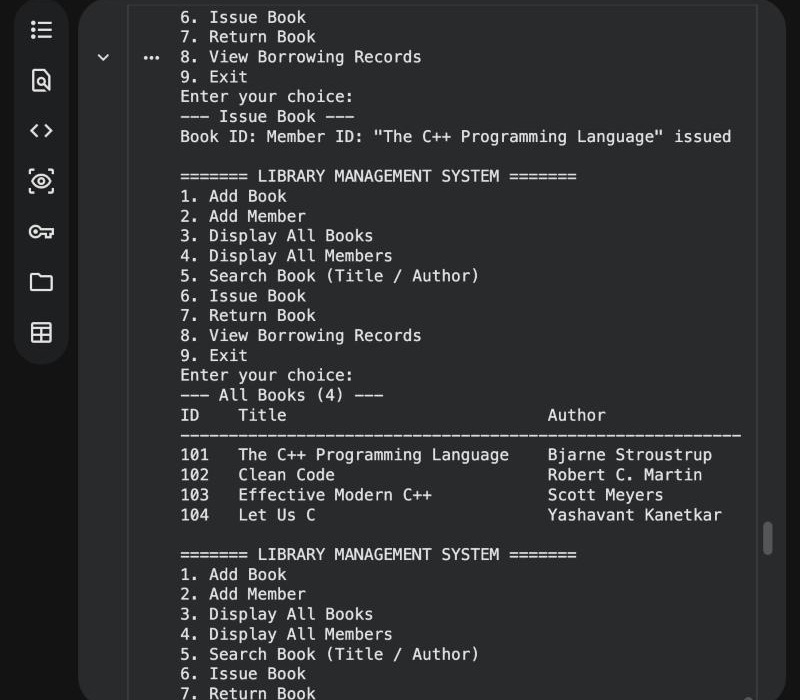
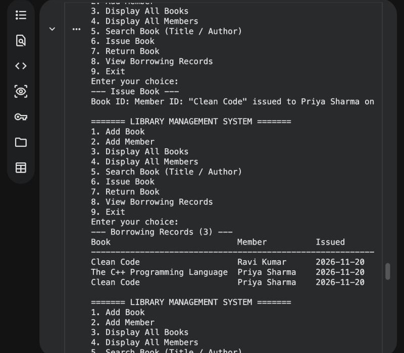
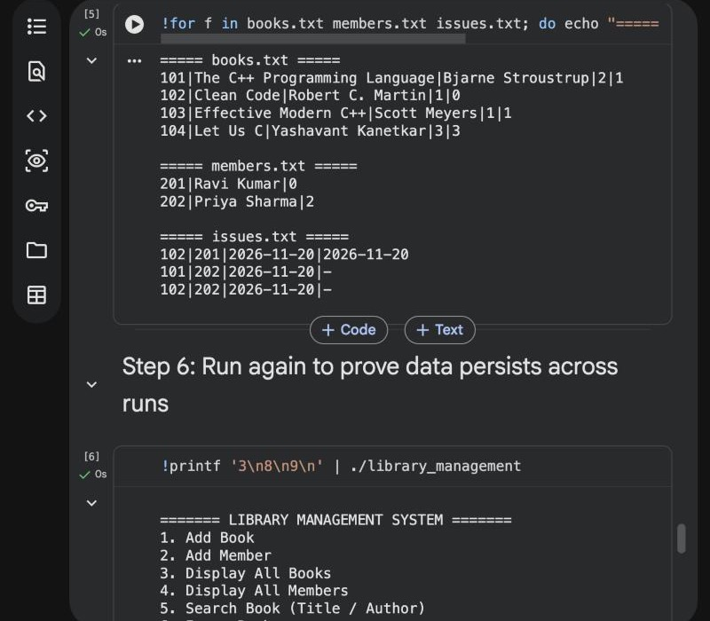

# Library Management System (C++)

A C++ console application that manages **books**, **members** and **borrowing records** using **Object-Oriented Programming** and **file handling**.

[](https://colab.research.google.com/github/suma544/library-management-system/blob/main/Library_Management_System.ipynb)

## Key Features
- **Classes and a structure for book and member details:**
  - `Book` holds the ID, title, author, and total and available copies
  - `Member` holds the ID, name and number of books borrowed (limit 3)
  - `IssueRecord` (struct) holds the book, member, issue date and return date
  - `Library` manages all of the data, the menu and file storage
- **Book issue:** checks that a copy is available, the member's 3-book limit, and duplicate issues
- **Book return:** records the return date and makes the copy available again
- **Search by title or author:** case-insensitive keyword search (e.g. "c++", "martin")
- **Borrowing records:** full history with Issued / Returned status
- **File handling:** data is saved in `books.txt`, `members.txt` and `issues.txt` and loaded again on the next run
- **Menu-driven** with input checks

## Files
| File | Description |
|------|-------------|
| `library_management.cpp` | Full C++ source code |
| `Library_Management_System.ipynb` | Google Colab notebook that writes, compiles and runs the program |
| `sample_input.txt` | Menu inputs used for the demo run |
| `output/colab_output.txt` | Full output from the Google Colab run |
| `output/books.txt`, `members.txt`, `issues.txt` | Data files produced by the program |
| `output/*.jpg` | Screenshots of the Colab run |

## Run it yourself
**Google Colab:** click the badge above, then *Runtime → Run all*.

**Locally:**
```bash
g++ -std=c++17 -o library_management library_management.cpp
./library_management
```

## Output Screenshots (Google Colab)




